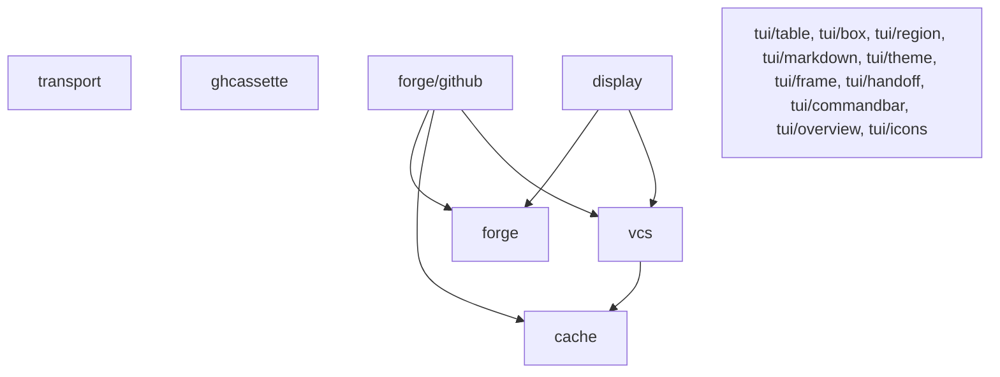

# Design

Architecture and the rules that decide what belongs here. The package inventory is
in [README.md](README.md), what an extraction costs is in
[docs/extraction.md](docs/extraction.md), and Go conventions are in
[AGENTS.md](AGENTS.md).

## What earns a package

Nothing is designed here first. A package arrives when a second tool needs code a
first tool already wrote and proved, so every package has at least one real consumer
and the API is whatever that consumer was already calling. `docs/extraction.md`
records the mechanics; the judgment call is the seam, which follows consumer
coupling rather than file boundaries.

The counterpart rule matters as much: a package leaves the consumer only once it has
no import back into that consumer's `internal/`. That is what makes each move a
mechanical rename at the call sites instead of a redesign.

## Layers

Three properties hold across that graph:

- The `forge` model and `vcs` never import each other. One is remote host state and
  the other is the local checkout, and a tool that shows both is the thing that joins
  them. `display` importing both is what lets that join live here instead of in every
  consumer. `forge/github` is the exception, and only downward: it calls `vcs.Stamp`
  to key its caches to a checkout and `vcs.GetGitHubEnv` to reach the right host
- The `tui/` packages import lipgloss and nothing else from this module. They are
  the only place a rendering library appears, so a consumer that wants the data
  packages pays nothing for the terminal ones
- `cache` sits under everything and depends on nothing. `transport` and `ghcassette`
  have no in-module consumer at all: each exists purely as a seam a tool wires into
  its own client, which is why gh-sweep can take one without taking `forge`. They
  divide by where the tool talks to GitHub, `transport` at an `http.RoundTripper` and
  `ghcassette` at the `gh` binary PATH resolves

## Rendering without a vocabulary

A palette is generic and style names are an application's vocabulary. `PROpenStyle`
and `NotesBadgeStyle` mean something to one dashboard and nothing here, so the split
runs between them: `tui/theme` ships the Catppuccin and Ink flavors and the
terminal-background detection, and each consumer keeps its own named styles built
from a palette.

`tui/frame` is the one that takes a whole `skin.Skin`, because a frame's job is to compose the faces (title, tab, key, status) a skin already names, and it was the second consumer's shell that earned it.

Everything else under `tui/` follows from that. `tui/markdown` takes a `Styles`
argument naming three roles rather than reaching for a palette, and `tui/table` and
`tui/region` take rendered strings and measure them. None of them can name a color.

`tui/skin` and `tui/icons` are the deliberate exceptions, and for the same reason: a
title's face and a Go file's icon are vocabulary the tools have to share, or three
tools invent three greys and three file glyphs. Each names roles out of a palette it
is handed and never a literal color. Every icon is one cell in both the Nerd Font set
(the default) and the unicode set, so the set a reader picks never moves a column.

A background is fitted to the terminal before it is drawn, never left to the
renderer's nearest match. The 256-color cube's darkest non-grey entries are fully
saturated (22, 52, 17), so a quiet wash quantizes to a block of green, red, or navy.
`theme.Ground` maps each background role to a step on the grey ramp by how far it
sits from the frame, and in 16 colors to nothing; the color that says which side a
line is on moves to the sign and the line number, which keep it at every depth.
`skin.For` and `skin.DiffFor` take the profile `colorprofile.Detect` answers, the
same answer Bubble Tea downsamples by, so the two never disagree about the depth.

`display` is the same rule one step further out: it emits plain strings with no
styling at all, because two tools reading one checkout style it differently even when
they agree on the words.

## Discoverability

`tui/keys`, `tui/palette`, `tui/coach`, `tui/empty`, `trail`, and `fuzzy` are the one place the
family answers "what can I do here, what next, and what did that run". They were designed
together for three consumers at once (jojo, jj-diff, second-look) rather than extracted from one,
so [docs/discoverability.md](docs/discoverability.md) carries the wiring each tool does and the
rules the pieces share:

- Every surface reads one source of truth per screen. A `keys.Gate` decides what is off and why,
  and the footer (`HintsAt`), the legend and palette (`LegendAt`, `palette.FromKeymap`), the
  coach (`All` skips a refused action), and the key press itself read it, so none can disagree
- `?` and `:` are one `palette.Model` in two modes over one entry list. A tool's help overlay is
  that component in browse mode, not a parallel layer
- Local state is split by consent. The coach `Ledger` (tip history, recent commands) is always on
  under `$XDG_STATE_HOME` and holds no keystrokes; the synced `keyusage` log stays opt-in, and
  everything that reads it works without it
- `fuzzy` and `trail` hold no styles in their data halves, so a tool that wants only the scorer or
  the log pays nothing for the views

## Detection is deterministic

`theme.Detect` reads `CATPPUCCIN_THEME` first and falls back to the terminal
background. A background it cannot query reads as dark, so a piped run, a captured
golden fixture, and CI all resolve to Macchiato instead of flipping on whether a TTY
was attached. `theme.Select` takes the override and the probe as arguments, which is
what makes that testable.

## Testing

Table-driven unit tests next to the code, in a `_test` package. Two seams exist
specifically so consumers can test against this module without a network or a
checkout:

- `transport` registers a fake `http.RoundTripper`, and its mutation guard panics on a
  real mutating request when no fake is registered, so a test can never write to a
  live API
- `ghcassette` puts a stand-in `gh` ahead of the real one on PATH, recording what the
  real binary printed or replaying it. Replay reaches nothing at all, since the stub
  has no `gh` to run
- `cache/testing.go` supplies an advanceable clock, a byte-budgeted disk store, and a
  store pointed at a test directory

`vcs` covers git and jj against real repositories created in `t.TempDir`, because the
behavior worth testing is what the binaries actually print.
