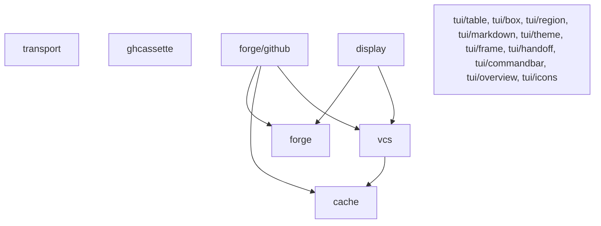

# Design

Architecture and the rules that decide what belongs here. The package inventory is
in [README.md](README.md), what an extraction costs is in
[docs/extraction.md](docs/extraction.md), and Go conventions are in
[AGENTS.md](AGENTS.md).

## What earns a package

Nothing is designed here first. A package arrives when a second tool needs code a
first tool already wrote and proved, so every package has at least one real consumer
and the API is whatever that consumer was already calling. `docs/extraction.md`
records the mechanics; the judgment call is the seam, which follows consumer
coupling rather than file boundaries.

The counterpart rule matters as much: a package leaves the consumer only once it has
no import back into that consumer's `internal/`. That is what makes each move a
mechanical rename at the call sites instead of a redesign.

## Layers

Three properties hold across that graph:

- The `forge` model and `vcs` never import each other. One is remote host state and
  the other is the local checkout, and a tool that shows both is the thing that joins
  them. `display` importing both is what lets that join live here instead of in every
  consumer. `forge/github` is the exception, and only downward: it calls `vcs.Stamp`
  to key its caches to a checkout and `vcs.GetGitHubEnv` to reach the right host
- The `tui/` packages import lipgloss and nothing else from this module. They are
  the only place a rendering library appears, so a consumer that wants the data
  packages pays nothing for the terminal ones
- `cache` sits under everything and depends on nothing. `transport` and `ghcassette`
  have no in-module consumer at all: each exists purely as a seam a tool wires into
  its own client, which is why gh-sweep can take one without taking `forge`. They
  divide by where the tool talks to GitHub, `transport` at an `http.RoundTripper` and
  `ghcassette` at the `gh` binary PATH resolves

## Rendering without a vocabulary

A palette is generic and style names are an application's vocabulary. `PROpenStyle`
and `NotesBadgeStyle` mean something to one dashboard and nothing here, so the split
runs between them: `tui/theme` ships the Catppuccin and Ink flavors and the
terminal-background detection, and each consumer keeps its own named styles built
from a palette.

`tui/frame` is the one that takes a whole `skin.Skin`, because a frame's job is to compose the faces (title, tab, key, status) a skin already names, and it was the second consumer's shell that earned it.

Everything else under `tui/` follows from that. `tui/markdown` takes a `Styles`
argument naming three roles rather than reaching for a palette, and `tui/table` and
`tui/region` take rendered strings and measure them. None of them can name a color.

`tui/skin` and `tui/icons` are the deliberate exceptions, and for the same reason: a
title's face and a Go file's icon are vocabulary the tools have to share, or three
tools invent three greys and three file glyphs. Each names roles out of a palette it
is handed and never a literal color. Every icon is one cell in both the Nerd Font set
(the default) and the unicode set, so the set a reader picks never moves a column.

A background is fitted to the terminal before it is drawn, never left to the
renderer's nearest match. The 256-color cube's darkest non-grey entries are fully
saturated (22, 52, 17), so a quiet wash quantizes to a block of green, red, or navy.
`theme.Ground` maps each background role to a step on the grey ramp by how far it
sits from the frame, and in 16 colors to nothing; the color that says which side a
line is on moves to the sign and the line number, which keep it at every depth.
`skin.For` and `skin.DiffFor` take the profile `colorprofile.Detect` answers, the
same answer Bubble Tea downsamples by, so the two never disagree about the depth.

## Terminal compatibility

The rules a screen holds to so it lines up and colors the same in the terminals
these tools are used in (WezTerm with a Nerd Font Mono, inside tmux, is the
reference setup):

- **Color depth comes from `theme.Profile`, and Bubble Tea is told it.** Inside
  tmux, TERM is tmux's own (`screen` unless `default-terminal` says otherwise)
  while COLORTERM is the outer terminal's, and `colorprofile.Detect` ignores
  COLORTERM there and asks `tmux info`, which a server with no client attached
  answers without RGB. `theme.Profile` honors `COLORTERM=truecolor` inside tmux;
  tmux passes RGB through when the outer entry carries it
  (`terminal-overrides ",xterm-256color:RGB"`). A tool hands the same answer to
  `tea.WithColorProfile`, so faces and renderer agree on the depth.
- **Backgrounds are fitted, never quantized** (`skin.For`, `skin.DiffFor`): tints
  in truecolor, grey-ramp steps in 256, none in 16.
- **A hue that says something keeps it** (`theme.Hue`). colorprofile's 256-color
  match lands some saturated colors on the grey ramp (Latte's red answers 241),
  which in 256 colors would leave a removed line's sign the same grey as its
  wash. The diff signs and the skin's Success, Warning, and Error go through
  `theme.Hue`, which answers the nearest non-grey cube entry instead.
- **Chrome uses width-stable glyphs only** (`tui/glyph`). No Emoji=Yes code point
  (⚠ ▶ ◀ ✔ ✖ ⬆ ⬇ ❤ ⏺: Fira Code has none of them, so WezTerm falls back to an
  emoji font and draws them two cells wide over one), no VS16 or ZWJ sequence,
  no wide glyph, and no private-use glyph outside `tui/icons`' Nerd set.
  `framecheck.Source` enforces it per module, and framecheck's Glyph rule per
  frame. The stand-ins: ▶ ▸, ◀ ◂, ⚠ ▲, ✔ ✓, ✖ ✗ or ✘, ☑ ☒, ⬇ ↓, ❤ ♡.
- **Icons default to unicode.** Nerd icons are opt-in (`ARAGONITE_ICONS=nerd`, or a
  tool's `icons = "nerd"`). A Nerd Font Mono draws them in one cell; a proportional
  one or a fallback draws two, so every Nerd icon is drawn as icon and space and
  the overflow lands on the blank.
- **Content is settled before it is measured** (`glyph.Settle`). WezTerm measures
  by Unicode 9 tables by default and tmux by its libc's, so an emoji newer than
  Unicode 9 (🩺 🟠) is one cell there and two to lipgloss, and a VS16 heart is one
  or two depending on grapheme clustering (mode 2027), which tmux answers for
  itself. Settle maps text-default emoji to their stand-ins, drops selectors, skin
  tones, and ZWJ tails, spells flags as letters, and draws ◌ for a recent emoji.
  Emoji from Unicode 9 and before, and CJK, are two cells everywhere and stay.
- **Code is measured, never settled.** A diff's code is drawn as written, so a
  line may hold any of the classes above. It is cut and padded with the same
  grapheme widths lipgloss uses, which is also what Bubble Tea's cell buffer
  places cells by and what tmux 3.4 advances (checked per class: a recent emoji,
  a VS16 heart, a ZWJ sequence, a skin tone, a flag, a text-default emoji), so
  the right edge and the scrollbar keep their column. Measuring a recent emoji
  as one cell, as a Unicode 9 terminal does, would not move them back: the cell
  buffer still counts two, so the row would overrun the frame and lose its last
  cell. Outside tmux, in a terminal measuring by older tables, such a row shifts
  by a cell after the emoji, which only the terminal's own width setting fixes.
- **The selected row in 16 colors is one even bar** (`skin.Selected`,
  `skin.Select`, `frame.Lit`). Selection there is reverse video, which turns a
  colored cell inside the row (a status letter, a `+3`) into a block of its
  color, so a cell inside the row drops its colors and keeps its weight. A tool
  draws its selected row through those calls rather than composing a face with
  `Selection` itself.

`display` is the same rule one step further out: it emits plain strings with no
styling at all, because two tools reading one checkout style it differently even when
they agree on the words.

## Discoverability

`tui/keys`, `tui/palette`, `tui/coach`, `tui/empty`, `trail`, and `fuzzy` are the one place the
family answers "what can I do here, what next, and what did that run". They were designed
together for three consumers at once (jojo, jj-diff, second-look) rather than extracted from one,
so [docs/discoverability.md](docs/discoverability.md) carries the wiring each tool does and the
rules the pieces share:

- Every surface reads one source of truth per screen. A `keys.Gate` decides what is off and why,
  and the footer (`HintsAt`), the legend and palette (`LegendAt`, `palette.FromKeymap`), the
  coach (`All` skips a refused action), and the key press itself read it, so none can disagree
- `?` and `:` are one `palette.Model` in two modes over one entry list. A tool's help overlay is
  that component in browse mode, not a parallel layer. Its key column is as wide as the widest
  key a row shows, capped at ten cells: a binding with several keys whose whole label is wider
  (`ctrl+e/shift+down`) shows its first key, and the rest are listed in the explainer pane's
  `keys` line and, in the strip, on the selected row, so one long label never cuts every
  description. A key is never cut mid-key
- Local state is split by consent. The coach `Ledger` (tip history, recent commands) is always on
  under `$XDG_STATE_HOME` and holds no keystrokes; the synced `keyusage` log stays opt-in, and
  everything that reads it works without it
- `fuzzy` and `trail` hold no styles in their data halves, so a tool that wants only the scorer or
  the log pays nothing for the views

## Read marks are content-addressed

`seen` names a hunk by its path and its lines (kind byte and text, never line numbers), so a mark
is a statement about text a reader saw rather than about a commit. That one choice is what lets a
mark survive a force-push in second-look and a rebase in jojo: a hunk whose text is unchanged has
the same id under the new head, and one whose text changed is a different hunk and reads as unread,
which is the answer wanted. Nothing is ever moved between heads, so there is no range-diff or blame
step to get wrong.

The id format is frozen. second-look wrote marks with it before the package existed, and
`seen/testdata` holds a file its v0.57.3 wrote over a patch of this repository, which the tests
read back id for id and re-write byte for byte. Changing the hash means every reader's marks read
as unread.

Where marks live is the caller's choice of directory and scope, because the right key differs:
second-look keeps one file per pull request beside its review, and jojo one per change id under
`$XDG_STATE_HOME`. The store is safe for two processes because a reader may have jojo and jj-diff
(or two second-look screens) open on one repository at once. A `Set` remembers what this process
changed since it loaded, and `Save` takes a lock file, rereads the disk, applies only those
changes, and renames a temporary file into place. A lock file rather than `flock` keeps that
identical on every platform and on network home directories, and a lock older than ten seconds is
taken to belong to a process that died and is broken. A save prunes marks for hunks the caller's
live diff no longer carries, so a file stays the size of one review.

Two tools share marks only if they name the same directory, so the jj repository a directory belongs
to is answered here (`JJRepo`) rather than by each tool. It walks up to the nearest `.jj` the way jj
does, follows a secondary workspace's `.jj/repo` pointer to the main store, and resolves symlinks,
so jojo started at a workspace root and jj-diff started in a subdirectory of another workspace of
the same repository reach one `RepoKey` without either asking jj.

## Detection is deterministic

`theme.Detect` reads `CATPPUCCIN_THEME` first and falls back to the terminal
background. A background it cannot query reads as dark, so a piped run, a captured
golden fixture, and CI all resolve to Macchiato instead of flipping on whether a TTY
was attached. `theme.Select` takes the override and the probe as arguments, which is
what makes that testable.

## Testing

Table-driven unit tests next to the code, in a `_test` package. Two seams exist
specifically so consumers can test against this module without a network or a
checkout:

- `transport` registers a fake `http.RoundTripper`, and its mutation guard panics on a
  real mutating request when no fake is registered, so a test can never write to a
  live API
- `ghcassette` puts a stand-in `gh` ahead of the real one on PATH, recording what the
  real binary printed or replaying it. Replay reaches nothing at all, since the stub
  has no `gh` to run
- `cache/testing.go` supplies an advanceable clock, a byte-budgeted disk store, and a
  store pointed at a test directory

`vcs` covers git and jj against real repositories created in `t.TempDir`, because the
behavior worth testing is what the binaries actually print.
